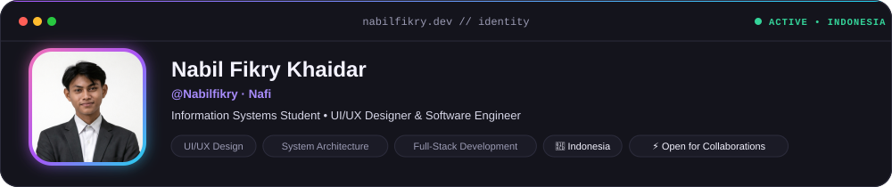
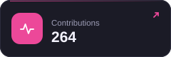
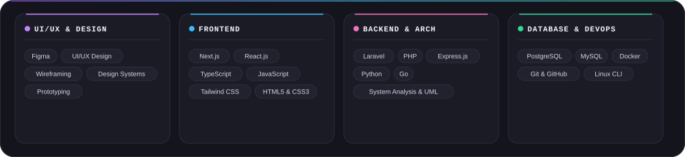

 

&nbsp;
&nbsp;
&nbsp;
&nbsp;

  

&nbsp;
&nbsp;
&nbsp;

 

### ✦ Activity & Code Overview

  

### ✦ Featured Projects

  &nbsp;
  
    
  &nbsp;
  

### ✦ Tech Stack & Architecture

  

### ✦ Analytics & Insights

  

### ✦ Contribution Snake

  

   
  DESIGNED WITH PURPOSE · ENGINEERED WITH PRECISION

